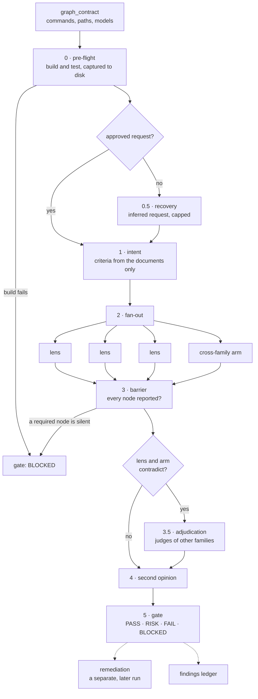

# quorate

Evidence-backed review, audit and code change for Claude Code: parallel agents, checked across model families,
reconciled into one gated verdict.

quorate is a framework for Claude Code, mounted as a git submodule; a plugin manifest gives its skills the
`quorate:` names. It reviews and audits work through parallel review lenses, each an isolated
subprocess, held at a barrier and reconciled into one verdict. It fixes what a review found in a separate, later run,
and it writes tests. Around those it gives you the steps before and after: recording what was asked, planning and
reviewing a plan, widening the options before a hard choice, and gating a release. Every finding cites evidence that a
captured command wrote to disk before the finding was claimed.

The name is the adjective: a meeting is *quorate* when enough members are present for its decisions to be valid. That
is the central rule: **a required lens that did not report makes the gate `BLOCKED`, never `PASS`. Silence is not a
verdict.**

> **Status: 0.x, pre-release.** Used daily against its own repository and one consuming project. The layout, the
> contract keys and the skill set still move. See [CHANGELOG.md](CHANGELOG.md) for what changed and what broke.

---

## Why this exists

Asking one model to review a diff produces one opinion, delivered fluently, with no way to tell a verified claim from a
plausible one. Three failure modes follow, and quorate is built around them rather than around the review itself:

1. **A reviewer that says nothing looks like a reviewer that found nothing.** A crashed lens, a timed-out lens and a
   clean lens all produce silence. So every node is committed to disk *before* it launches, and a node that never
   reports blocks the gate instead of vanishing from it.

2. **Agreement between models of the same family is one opinion counted twice.** So the judgment lenses are shadowed by
   arms from a different vendor, and where a lens and an arm contradict each other, judges of other families rule.

3. **A claim with no evidence reads exactly like a claim with evidence.** So a finding must cite a path written by a
   captured command inside the run, and a path nobody printed is rejected mechanically rather than argued with.

None of these are model problems. A stronger model does not know whether a file exists without opening it, and cannot
tell you it stayed silent because it crashed.

---

## What it does

The skills are what a person invokes in a Claude Code session (namespaced by the plugin: `quorate:full-review`). In
normal use nobody runs the engine by hand: you ask, and the session follows the skill.

**Review and audit**
- `full-review`: the whole graph over a change: pre-flight checks, intent, the lenses and their cross-family arms, the
  barrier, reconciliation, a gate.
- `invoke`: one lens through the same path ("security-audit this endpoint"). It narrows the fan-out and nothing else.
- The lenses themselves, spawned by the engine, never pasted into a session: `contract-audit` (did it do what was
  asked), `code-audit`, `security-audit`, `arch-review`, `doc-consistency-review`, `perf-audit`, `ui-audit`,
  `feature-verify`.

**Writing code and tests**
- `remediate`: fixes a finished review's confirmed findings in a separate run, by a node in its own context, then
  commits each fix only after the project's full check passes on it.
- `unit-test-writer`, `integration-test-writer`: tests that pin one behaviour, or prove a flow through the real
  entrypoint.

**Planning and capture**
- `request`: what a conversation converged on, in the operator's own words, as the approved request a review judges
  the work against.
- `plan-authoring` and `plan-review`: write a plan from the roadmap, then gate it against the roadmap before work starts.
- `candidate-pool`: three model families propose options before a hard-to-reverse choice.
- `version-gate`: checks a milestone's definition of done against recorded run evidence.
- `claim-check`: checks the agent's own report before you read it: a fresh checker looks for what would make each
  claim a non-issue.
- `graph-plan`: how to split new parallel agent work.

**Long runs**
- `scripts/run-session.mjs`: one approved plan worked through over hours or days, its state printed into each session.
- The decision panel (`review.decision_panel`): a question with options answered by three seats of different families,
  by majority, instead of the operator; decisions below a declared grounding floor still go to the operator.
- The code index (`scripts/code-index.mjs`): structural questions about a codebase (does this symbol exist, who calls
  it) answered from declared extractors, with "could not tell" never reported as "no".

---

## What a run does

Every command, path, budget and model comes from a `graph_contract` block the project declares. Nodes never discover
their own environment.



| Phase | What happens |
|---|---|
| **0 · pre-flight** | The declared `build`, `test`, `lint`, `fmt_check`, `typecheck`, `audit` and `deny` commands run through `capture.mjs`, which writes their real output to disk. A failed build stops the run. A result whose inputs have not changed is reused, and the gate says so. |
| **0.5 · recovery** | Only when no approved request exists: an inferred one is drafted from the documentation, the run is stamped `REQUEST-INFERRED`, and the conformance lens is capped as `shared/disk-first-protocol.md` §7 states. |
| **1 · intent** | Reads the declared documents *and nothing else*, sandboxed away from the source, and writes the numbered criteria the run is judged against. A criterion written after seeing the code would describe what was built. |
| **2 · fan-out** | The lenses run concurrently, each in its own subprocess with its own permission policy. Cross-family arms run beside them on the same criteria. |
| **3 · barrier** | A clean subprocess reads every status file and every finding, groups them, and rules on each. It never reports findings of its own. |
| **3.5 · adjudication** | Only where a lens and an arm contradict each other. Silence from one side is not a dispute. |
| **4 · second opinion** | Reads the reconciliation and argues with it. |
| **5 · gate** | One verdict, with every stamp, every uncapped budget and every skipped check named in `not_checked[]`. |

---

## What it costs

A review spends model quota with every vendor it calls. The measured figures below are from this repository reviewing
itself, 151 reviews from 2026-11-01 to 2026-11-15 (`scripts/telemetry.mjs report`). That is a large repository, and a
consuming project's own figures will differ:

- **Time:** median 21.8 minutes per review, end to end; the fan-out's median was 12.5 minutes.
- **Claude (the lenses, intent, reconciliation, second opinion):** about $6.60 per review, vendor-reported, which is
  API-equivalent spend; on a subscription it is quota instead.
- **Codex (the six shadow arms):** about 14 million input tokens per review, about 95% of them cached.
- **Remediation:** median 16.2 minutes per remediation run, Claude about $3.10 per run (n=120).

See your own with `node .claude/skills/quorate/scripts/telemetry.mjs report`, which prints each figure beside its
sample size. The contract's budget keys cap spend per node, per barrier and per run; the shipped template declares
numbers, and an empty key means uncapped, stamped `UNCAPPED-BUDGET` on every run.

---

## What leaves the machine

- **Claude itself.** Every lens, every node and every Claude subagent is a call to Anthropic's API, with your prompt
  and whatever files it reads.
- **The external panel, off by default.** With `review.external_panel: true`, prompts go to the configured
  reviewers' clouds (Codex and agy by default). The prompt is the floor of what leaves, not the ceiling: an agentic
  reviewer reads further files on its own. The panel's rules, including what the arms' working directory holds, are
  [`shared/external-reviewers.md`](shared/external-reviewers.md).
- **The claim checker's transcript.** With the panel on and `claim_check_transcript: cross-family`, a redacted, reduced
  copy of the session's conversation goes to the other family's checker. The template's default, `same-family`, sends
  none.

---

## Other models and harnesses

Nothing in the engine names a vendor; three separate decisions are declared:

- **Which CLI:** [`scripts/reviewers.json`](scripts/reviewers.json) is an adapter table, as data: how a reviewer is
  invoked, what it can do, which credentials it may receive, how its usage is read back. A project adds its own under
  `reviewers:` in its contract without editing the engine; an override of a built-in is named wherever it is used.
- **Which model, for which role:** [`scripts/lens-roster.json`](scripts/lens-roster.json), per lens and per arm.
- **The node runtime:** lenses run through the contract's runtime, `claude -p` by default; another runtime is a table
  entry declaring its own equivalents ([`shared/adapter-contract.md`](shared/adapter-contract.md)), and `--runtime-bin`
  points the engine at a different binary.

What has been exercised, and what has not:

| | Exercised |
|---|---|
| Claude Code as the lens runtime | daily, on this repository and one consuming project |
| Codex as the shadow arms and the claim checker | daily |
| agy (Gemini) and Codex as adjudicators | in real reviews; agy's seat on the decision panel has answered no round yet |
| A second lens runtime | **not exercised.** The table and `--runtime-bin` are tested with a fake runtime only |
| A reviewer added under `reviewers:` | tested in the suite only |

Claude Code is today the only runtime that provides the lens sandbox (path-scoped reads, tools denied, a captured
evidence channel). A runtime declaring those capabilities is making a claim this framework cannot yet probe; that gap is
named in the contract rather than papered over.

**Adapting to a project** is by instruction, not by fork: a project's own idiom goes in `.claude/quorate/` (a profile
for every node, or one per node or skill), and five skills carry an `ADAPT.md` prompt that writes theirs from evidence
in your tree (`unit-test-writer`, `integration-test-writer`, `plan-authoring`, `plan-review`, `version-gate`).

---

## Using it

A consuming project mounts quorate as a git submodule at `.claude/skills/quorate/`, where the
`.claude-plugin/plugin.json` manifest is discovered in place with no install step.

**[QUORATE.md](QUORATE.md) is the setup guide:** the contract template, the hooks, the panel, and how sessions use it.
Start there.

To watch it review itself, from a checkout of this repository:

```
node scripts/new-run.mjs --dry-run          # resolve the contract, spawn nothing
node scripts/new-run.mjs --slug self --full-sweep scripts shared skills tests
node scripts/run-graph.mjs --run-dir <the run dir new-run printed>
```

Zero runtime dependencies: Node (every maintained LTS line), git, and whichever reviewer CLIs you configure. CI runs
the suite on Linux and Windows on every push to the default branch and every pull request; macOS runs when started by
hand.

---

## Where things are written down

Each document **owns** its subject. Where two disagree, the owner wins.

| Document | Owns |
|---|---|
| [`shared/disk-first-protocol.md`](shared/disk-first-protocol.md) | The protocol every skill cites: severity and verdict ladders, evidence rules, the non-waivable invariants, the recursion guard. **Read this one first.** |
| [`shared/claude-md-contract.md`](shared/claude-md-contract.md) | What every `graph_contract` key means, and what an empty one does. |
| [`shared/external-reviewers.md`](shared/external-reviewers.md) | The cross-family panel: what leaves the machine, and on whose consent. |
| [`shared/adapter-contract.md`](shared/adapter-contract.md) | What each role needs from a runtime or a reviewer, and what is lost without it. |
| [`shared/unverified-claims.md`](shared/unverified-claims.md) | What this framework does **not** verify, named and dated. |
| [`ARCHITECTURE.md`](ARCHITECTURE.md) | The engine's structure, as a specification the reviews hold it to. |
| [`QUORATE.md`](QUORATE.md) | Consumer onboarding and setup. |
| [`CONTRIBUTING.md`](CONTRIBUTING.md), [`SECURITY.md`](SECURITY.md) | How to contribute, and how to report a vulnerability. |

**Design records are private.** The documents, code comments and tests cite the requests, plans and design notes each
change was decided in (`.claude/requests/...`), and the review runs that checked it (`.claude/reviews/...`). Those stay
in the private development repository, so in a public copy the citations are provenance you cannot open; a test that
reads one says so and skips.

---

## Tests

4713 regression tests. Every one records the defect it exists to prevent, in its own text. The count is verified
against the tree on every push, because a stated number that has gone stale is an inert guarantee.

```
node tests/run-all.mjs
```

---

## License

Apache License 2.0: see [`LICENSE`](LICENSE) and [`NOTICE`](NOTICE).
